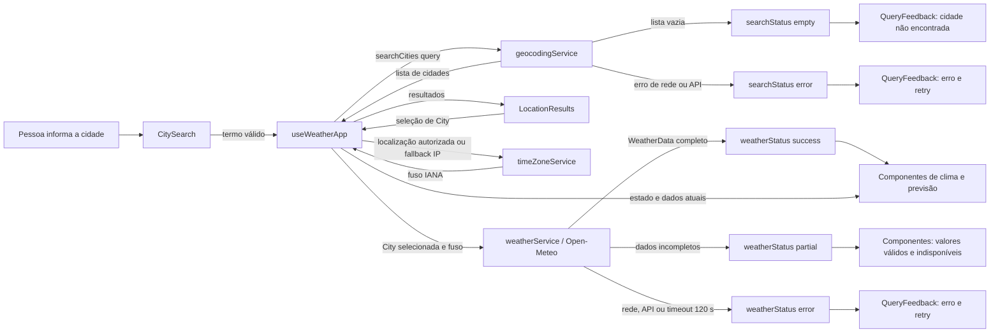

# Plano Técnico: Weather App

Fonte da verdade: `specs/weather-app-spec.md`. Os campos mínimos atuais são temperatura e condição; em cada dia da previsão, mínima, máxima e condição. As decisões sobre fuso por IP, privacidade e comportamento se nenhum fuso puder ser obtido permanecem dependências explícitas.

## Architecture

Aplicação web de página única (SPA), executada no navegador, sem backend próprio. O fluxo usa quatro camadas pequenas, com dependências em uma só direção: `components` → `hooks` → `services` → APIs externas; `lib` contém funções puras usadas pelas demais camadas.

- **Apresentação (`components`):** componentes recebem dados e callbacks por props, renderizam resultados e estados acessíveis e não fazem chamadas de rede nem decidem regras do domínio.
- **Orquestração e estado (`hooks`):** `useWeatherApp` controla a busca, seleção, consulta, loading/empty/error/partial, retry, unidade e fuso. Coordena serviços, mas não conhece detalhes do JSON Open-Meteo nem contém formatação complexa.
- **Acesso a dados (`services`):** cada serviço encapsula uma integração externa, constrói a requisição, aplica timeout, verifica falhas HTTP e entrega dados no modelo de domínio. Não acessa React nem elementos de interface.
- **Funções puras (`lib`):** normalizadores dos payloads, conversão de temperatura, mapeamento de códigos meteorológicos e formatação de datas. Não fazem I/O, não leem estado global e recebem os dados necessários por argumento.

Não consultar a previsão até a pessoa selecionar uma cidade. Celsius será a unidade canônica do modelo; alternar unidade atualiza somente a apresentação. Dados de usuário não serão enviados a servidor próprio nem persistidos.

A resolução do fuso terá uma interface independente: localização do navegador autorizada gera coordenadas, convertidas para fuso IANA por um serviço; com permissão negada ou localização indisponível, usa-se inferência por IP. O provedor, retenção e fallback quando ambos falharem precisam ser aprovados antes de integrar essa parte.

Essa separação permite testar componentes com props previsíveis, hooks com serviços simulados, serviços com `fetch` mockado e funções de `lib` com entradas/saídas determinísticas. Playwright cobre apenas os fluxos integrados essenciais.

## Tech Stack

- React 19 e TypeScript 6 em modo strict; Vite 8.
- Tailwind CSS 3.4, seguindo o tema e tokens existentes.
- pnpm como gerenciador; Biome para lint e formatação.
- Vitest, jsdom e Testing Library para testes unitários/de componentes; Playwright para E2E.
- APIs nativas `fetch`, `AbortController` e Geolocation API. Não incluir biblioteca global de estado nem cliente HTTP adicional sem necessidade demonstrada.

## Project Structure

```text
src/
  App.tsx
  main.tsx
  components/
    CitySearch.tsx
    LocationResults.tsx
    CurrentWeather.tsx
    FiveDayForecast.tsx
    TemperatureUnitToggle.tsx
    QueryFeedback.tsx
  hooks/
    useWeatherApp.ts
  services/
    geocodingService.ts
    weatherService.ts
    timeZoneService.ts
  lib/
    openMeteoMapper.ts
    temperature.ts
    weatherCode.ts
    dateTime.ts
  types/
    weather.ts
```

- `App.tsx` compõe a tela e conecta o hook aos componentes; `main.tsx` monta a aplicação.
- `components/` contém somente UI e interação local; cada componente recebe dados/callbacks via props.
- `hooks/useWeatherApp.ts` possui o estado da jornada e chama contratos de serviço; é o ponto de teste das transições e retries.
- `services/` contém uma fronteira por integração: geocodificação, forecast e fuso. Serviços lidam com `fetch`, status HTTP e timeout.
- `lib/openMeteoMapper.ts` converte JSON externo validado para `City`/`WeatherData`; os demais módulos são funções puras de apresentação e conversão.
- `types/weather.ts` define apenas contratos de domínio compartilhados, não tipos internos da resposta HTTP.
- Testes ficam fora de `src/`: `tests/setup.ts`, `tests/unit/` para componentes/hooks/services/lib e `tests/e2e/` para jornadas. Não criar abstração ou subpasta até haver mais de um caso real que a justifique.

## Data Model

Tipos de domínio não devem expor diretamente o formato bruto das respostas externas. O modelo mantém temperaturas em Celsius; `Unit` controla somente a apresentação.

```ts
export type Unit = 'celsius' | 'fahrenheit';

export interface City {
  id: number; // Identificador da cidade retornado pela geocodificação
  name: string; // Nome da cidade retornado pela geocodificação
  admin1: string | null; // Estado ou região administrativa, quando disponível
  country: string | null; // País, quando disponível
  latitude: number; // Latitude usada para consultar a previsão
  longitude: number; // Longitude usada para consultar a previsão
}

export interface CurrentWeather {
  temperatureC: number | null; // Temperatura atual em Celsius
  weatherCode: number | null; // Código WMO da condição atual
  time: string | null; // Horário da observação, conforme retornado pela API
}

export interface ForecastDay {
  date: string; // Data local no formato YYYY-MM-DD
  minTemperatureC: number | null; // Temperatura mínima em Celsius
  maxTemperatureC: number | null; // Temperatura máxima em Celsius
  weatherCode: number | null; // Código WMO da condição diária
}

export interface WeatherData {
  city: City; // Localidade selecionada pela pessoa
  timeZone: string; // Fuso IANA usado para as datas e horários
  current: CurrentWeather; // Condições atuais; campos indisponíveis como null
  forecast: ForecastDay[]; // Cinco dias consecutivos, inclusive períodos parciais
  retrievedAt: string; // Instante da consulta no formato ISO 8601
}
```

Contratos principais: `searchCities(query: string): Promise<City[]>`; `getWeather(city: City, timeZone: string, signal: AbortSignal): Promise<WeatherData>`; `resolveTimeZoneFromCoordinates(coords): Promise<string>`; `resolveTimeZoneFromIp(): Promise<string>`. Geocodificação sem resultados retorna lista vazia. Campo meteorológico ausente vira `null`; estrutura impossível de interpretar é erro. `weatherCode` conserva o código WMO da API e é convertido para texto/localização na camada de apresentação.

## Data Flow



O hook é o ponto de coordenação e expõe estados/dados aos componentes. Lista vazia não é erro; erros de serviço e timeout seguem o caminho de erro; respostas incompletas seguem o estado `partial`.

## External APIs

- **Geocodificação Open-Meteo:** `GET https://geocoding-api.open-meteo.com/v1/search?name={cidade}&count=10&language=pt&format=json`. `name` é o único texto de busca exigido pela spec; codificar o valor para URL. `count` limita resultados, `language` solicita nomes em português quando disponíveis e `format=json` explicita o formato.

  Exemplo resumido de resposta:

  ```json
  {
    "results": [
      {
        "id": 2267057,
        "name": "Lisboa",
        "latitude": 38.7167,
        "longitude": -9.1333,
        "admin1": "Lisboa",
        "country": "Portugal"
      }
    ],
    "generationtime_ms": 0.2
  }
  ```

  Mapear cada item de `results` para `City`: `id`, `name`, `admin1`, `country`, `latitude` e `longitude`. `admin1` e `country` podem não vir na resposta; normalizar a ausência para `null`. Se não houver correspondências, a resposta pode omitir `results`; normalizar para `City[]` vazio, não erro. Não enviar `forecast` quando o array estiver vazio.

- **Previsão Open-Meteo:** `GET https://api.open-meteo.com/v1/forecast?latitude={latitude}&longitude={longitude}&current=temperature_2m,weather_code&daily=temperature_2m_min,temperature_2m_max,weather_code&forecast_days=5&temperature_unit=celsius&timezone={iana}`. `current` solicita temperatura atual e código WMO; `daily` solicita mínima, máxima e código diário; `forecast_days=5` fixa hoje mais quatro dias; `temperature_unit=celsius` mantém o modelo canônico; `timezone` recebe o fuso IANA já resolvido para o local de acesso. Codificar o fuso como parâmetro de URL.

  Exemplo resumido de resposta:

  ```json
  {
    "timezone": "Europe/Lisbon",
    "current": {
      "time": "2026-11-11T13:15",
      "temperature_2m": 18.2,
      "weather_code": 3
    },
    "daily": {
      "time": ["2026-11-11", "2026-11-12", "2026-11-13", "2026-11-14", "2026-11-15"],
      "temperature_2m_min": [14.1, 13.8, 12.9, 13.2, 14.0],
      "temperature_2m_max": [19.4, 20.1, 18.7, 19.0, 20.2],
      "weather_code": [3, 2, 61, 3, 1]
    }
  }
  ```

  Mapear `current.temperature_2m` para `CurrentWeather.temperatureC`, `current.weather_code` para `weatherCode` e `current.time` para `time`. Construir cada `ForecastDay` combinando, pelo mesmo índice `i`, `daily.time[i]`, `daily.temperature_2m_min[i]`, `daily.temperature_2m_max[i]` e `daily.weather_code[i]`. Mapear os arrays para no máximo cinco dias; ausência de valor em um campo vira `null`, sem deslocar os dados de outros índices. Mapear `timezone` da resposta para `WeatherData.timeZone`, `current` para `current` e os dias para `forecast`. `retrievedAt` é o instante local da recepção (`toISOString()`), não `current.time`.

  `weatherCode` conserva o código WMO numérico; a descrição localizada da condição será derivada em `lib/weatherCode.ts`. Antes de integrar em produção, validar o formato da resposta, erros HTTP, cobertura, limites, atribuição e termos de uso da Open-Meteo.

- **Fuso horário:** manter interface `resolveTimeZoneFromCoordinates` e `resolveTimeZoneFromIp`. Não escolher fornecedor de IP até validação de privacidade, retenção e termos. Geolocalização do navegador fornece coordenadas, não fuso.
- Aplicar timeout de 120 segundos por solicitação HTTP externa com `AbortController`. Não fazer retry automático. O timeout da Geolocation API não está definido na spec e deve ser decidido separadamente.

## State Management

O estado da aplicação vive em um único hook React, `useWeatherApp`, compartilhado com `App` e passado aos componentes por props. Usar `useReducer` nesse hook para tornar explícitas as transições assíncronas; não adicionar Context ou store global.

- **Busca:** `searchStatus` é `idle | loading | success | empty | error`; junto dele vivem `query`, `locations` e `searchError`. `empty` significa geocodificação bem-sucedida sem resultados; não é erro.
- **Clima:** `weatherStatus` é `idle | loading | success | partial | error`; junto dele vivem `selectedCity`, `weatherData` e `weatherError`. `partial` indica resposta utilizável com um ou mais campos/períodos ausentes. `empty` não se aplica ao forecast: cidade sem resultados pertence ao fluxo de busca.
- **Fuso:** `timeZoneStatus` é `idle | loading | success | error`; `timeZone` guarda o identificador IANA e `timeZoneError` a falha. A localização do navegador e o fallback por IP são passos da mesma operação, sem estado global separado.
- **Apresentação:** `unit` é `Unit` e começa em `celsius`. A seleção fica em memória durante a sessão; persistência entre visitas continua fora da decisão atual.
- Guardar temperaturas somente em Celsius no `WeatherData`. Na renderização, `temperatureC == null` continua indisponível; caso contrário, `lib/temperature.ts` converte para Fahrenheit com `F = C * 9 / 5 + 32` quando `unit === 'fahrenheit'`. A conversão é derivada a cada render e não dispara efeito, atualização de dados nem requisição. Arredondar apenas na formatação, nunca no valor canônico; precisão visual proposta de até uma casa decimal, sujeita à aprovação da regra de arredondamento.
- Manter busca e cidade selecionada durante loading/erro para que retry manual não exija nova digitação. Evitar duplicar valores derivados no estado.

## Error Handling

- **Rede:** rejeição de `fetch` (offline/DNS/conexão) vira erro `network`, com mensagem pt-BR de indisponibilidade. Preservar query/cidade e oferecer retry manual; nunca apresentar como cidade inexistente.
- **API/HTTP:** resposta não-2xx ou payload de erro do provedor vira erro `api`; registrar status e detalhe técnico apenas para diagnóstico, apresentar mensagem segura e permitir retry conforme a falha. Resposta de geocodificação sem resultados continua sendo `empty`, não `api`.
- **Timeout:** cada requisição HTTP usa `AbortController` e limite de 120 segundos. Distinguir abort causado pelo timeout de cancelamento iniciado por nova busca/desmontagem; o timeout vira erro `timeout`, encerra loading e oferece retry preservando a etapa válida anterior.
- **Resposta inválida:** JSON ilegível ou estrutura incompatível vira `invalid_response`; não mapear valores inventados e não tratar ausência de um campo isolado como erro estrutural.
- **Resposta parcial:** não é falha de transporte. Mapear campos meteorológicos ausentes para `null`, marcar o resultado `partial`, exibir os campos/dias válidos e identificar indisponíveis os demais. Manter as cinco datas e não preencher lacunas com zero ou dados antigos.
- **Fuso:** se geolocalização e IP falharem, usar `timeZoneStatus=error` e comunicar que não foi possível determinar o fuso. A política de fallback final continua pendente; não substituir silenciosamente pelo fuso da cidade consultada.
- Mensagens de erro e estados devem ser acessíveis e em pt-BR, sem expor payloads, endereço IP ou detalhes internos.

## Testing Strategy

- **Vitest — funções puras:** cobrir conversão Celsius/Fahrenheit em ambos os sentidos, valores `null`, precisão de exibição proposta; mapeamento de códigos WMO conhecidos/desconhecidos; datas de cinco dias e formatação em diferentes fusos; normalização de respostas completas e parciais. Estes testes não usam DOM, rede nem relógio real.
- **Vitest — services:** mockar `fetch` e verificar URL/parâmetros dos endpoints, mapeamento de payload, lista de geocodificação vazia, HTTP não-2xx, erro de rede, JSON inválido, campos ausentes e cancelamento pelo timeout. Usar fake timers/`AbortSignal` para testar os 120 segundos sem aguardar dois minutos reais; confirmar que retry é explícito e não automático.
- **Vitest — hook/orquestração:** mockar services e verificar transições `idle → loading → success|empty|partial|error`, preservação de busca/cidade no retry, busca sem forecast antes da seleção, unidade inicial Celsius e troca de unidade sem invocar `getWeather` novamente.
- **Vitest + Testing Library — componentes:** renderizar os estados `loading`, `error`, `empty`, `success` e `partial`; verificar texto e resultados, seleção de cidade, tentativa novamente, campos indisponíveis e unidade. Usar `user-event` para teclado e interação; mocks de serviços mantêm os testes determinísticos.
- **Vitest — localização/fuso:** mockar Geolocation API e `timeZoneService` para autorização, negação, indisponibilidade, fallback por IP e falha de resolução. Não chamar provedor real.
- **Playwright — E2E:** interceptar APIs com `page.route` e validar: busca → seleção → clima atual e cinco dias; cidade ambígua; cidade sem resultados; alternância de unidade sem nova chamada de forecast; erro e retry; resposta parcial; caminhos de timezone. Verificar layout/ausência de rolagem horizontal em viewport mobile de 320 px e desktop representativo.
- E2E não usa serviços externos reais nem aguarda timeout real; timeout é coberto com tempo simulado em Vitest. Manter poucos E2E cobrindo jornadas de risco, deixando casos de combinações para testes rápidos.
- Executar gates existentes: `pnpm lint`, `pnpm build`, `pnpm test`, `pnpm test:e2e`. Criar `tests/setup.ts`, já referenciado em `vite.config.ts`.

## Risks & Trade-offs

- **Estado local no hook vs. store global:** `useReducer` dentro de `useWeatherApp` mantém estado e transições juntos para uma única jornada. Redux/Zustand/Context facilitaria estado compartilhado entre várias rotas ou persistência, mas adicionaria dependência e conceitos sem necessidade atual; reavaliar se o app crescer para múltiplos fluxos.
- **`fetch` nativo vs. Axios/React Query:** `fetch` evita dependência e deixa explícitos timeout, parsing e erros. Axios ou TanStack Query ofereceriam interceptors, cache e deduplicação, mas são complexidade adicional sem requisito atual de cache/refetch.
- **Modelo canônico Celsius vs. consultar cada unidade:** guardar Celsius e derivar Fahrenheit na apresentação evita requisição ao alternar e mantém uma fonte única para os valores. A alternativa é pedir cada unidade ao provedor, que aumenta chamadas e pode produzir inconsistência de arredondamento.
- **Open-Meteo direto do browser vs. backend proxy:** chamada direta é simples e não requer backend para a API meteorológica; proxy permitiria cache e controle de tráfego, mas exige infraestrutura e operação fora do escopo atual. A inferência de fuso por IP continua exigindo avaliação de privacidade/provedor.
- **Geolocalização + IP vs. fuso do dispositivo:** o fluxo especificado tenta identificar o local de acesso, mas exige permissão e provedor para converter coordenadas/IP em IANA, com riscos de precisão e privacidade. Usar apenas `Intl.DateTimeFormat().resolvedOptions().timeZone` evitaria permissão e consulta externa, mas reflete a configuração do dispositivo, que pode não corresponder ao local real; não substituir a spec sem aprovação.
- **Timeout de 120 s vs. timeout curto:** manter 120 segundos cumpre a decisão da spec, mas pode prolongar o loading; 10–30 segundos melhoraria a percepção em falhas, porém mudaria o requisito. Mostrar estado de carregamento e permitir retry manual.
- **Mais testes de unidade vs. mais E2E:** funções, services e estados cobertos em Vitest rodam rápido e localizam falhas; Playwright valida integração real da UI, mas é mais lento e sensível a ambiente. Usar E2E apenas nos fluxos críticos e viewport mobile.
- **Fuso/IP:** fornecedor, privacidade, retenção e fallback final estão abertos. Isolar a integração em serviço e não liberar IP para terceiro antes da validação.
- **Fuso do acesso versus cidade consultada:** pode haver mudança de data para destinos em outros fusos; seguir a spec, que define fuso do acesso.
- **Timeout de 120 segundos:** requisito é longo para UX; mostrar loading claro e permitir retry, sem encurtar sem aprovação.
- **Open-Meteo:** cobertura, limites, atribuição e termos ainda precisam de confirmação; não assumir SLA além do controle do app.
- **Escopo meteorológico:** campos mínimos alinhados são temperatura/condição atual e mínima/máxima/condição diária; devem permanecer sincronizados com a spec.
- **Frescor, browser support e metas RNF:** frequência de atualização, navegadores, medição de desempenho/disponibilidade e validação WCAG continuam pendentes de produto.
- **Sem backend:** simplifica custo e operação, mas o fallback por IP transfere dado de rede a fornecedor externo.
